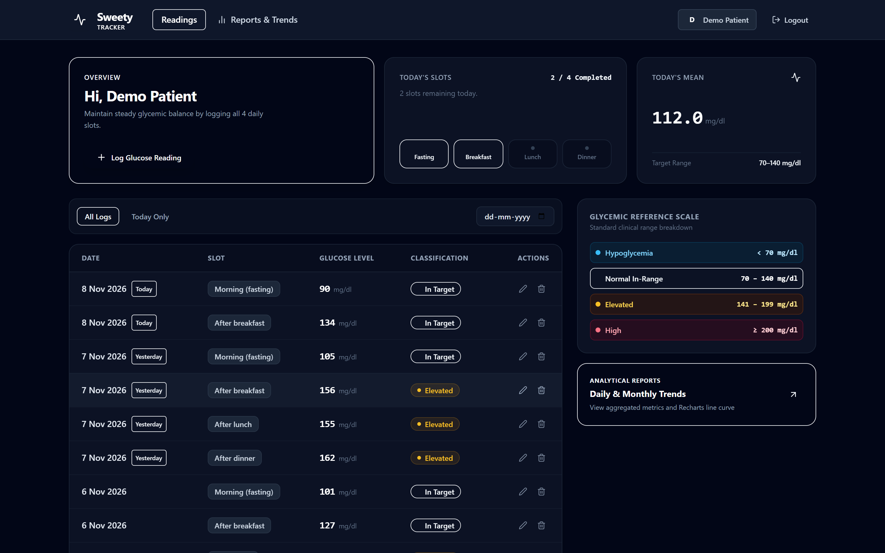
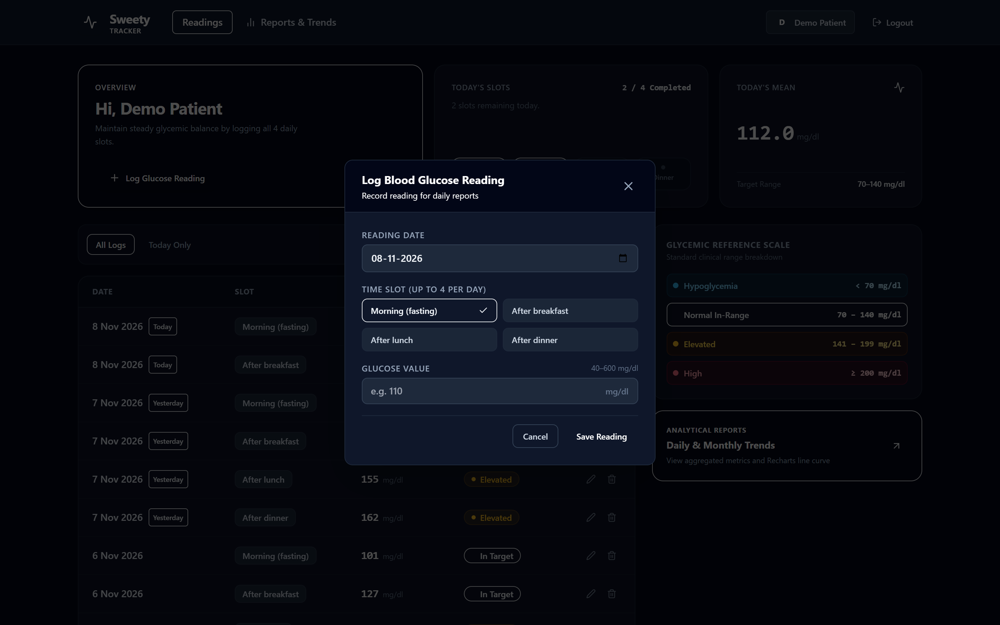
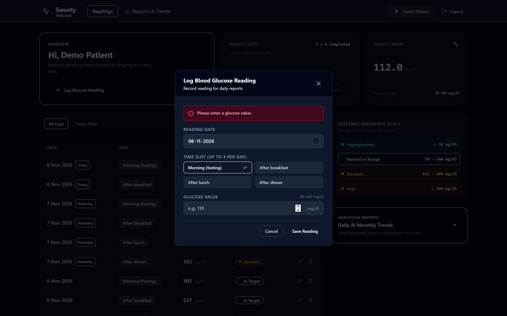
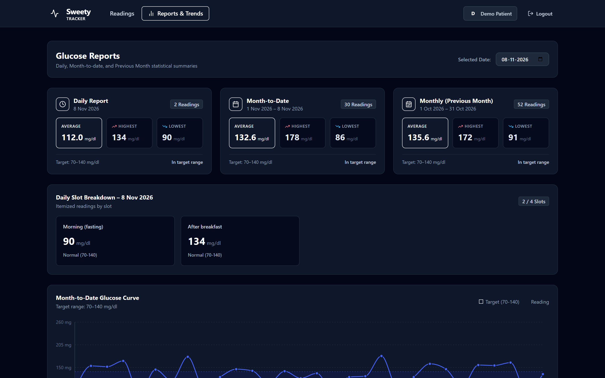
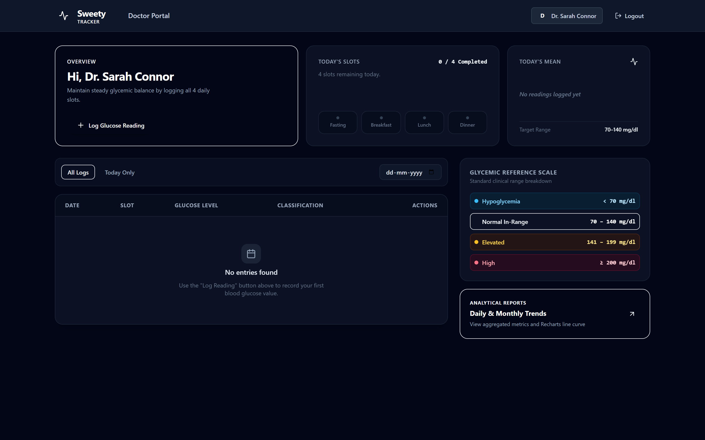
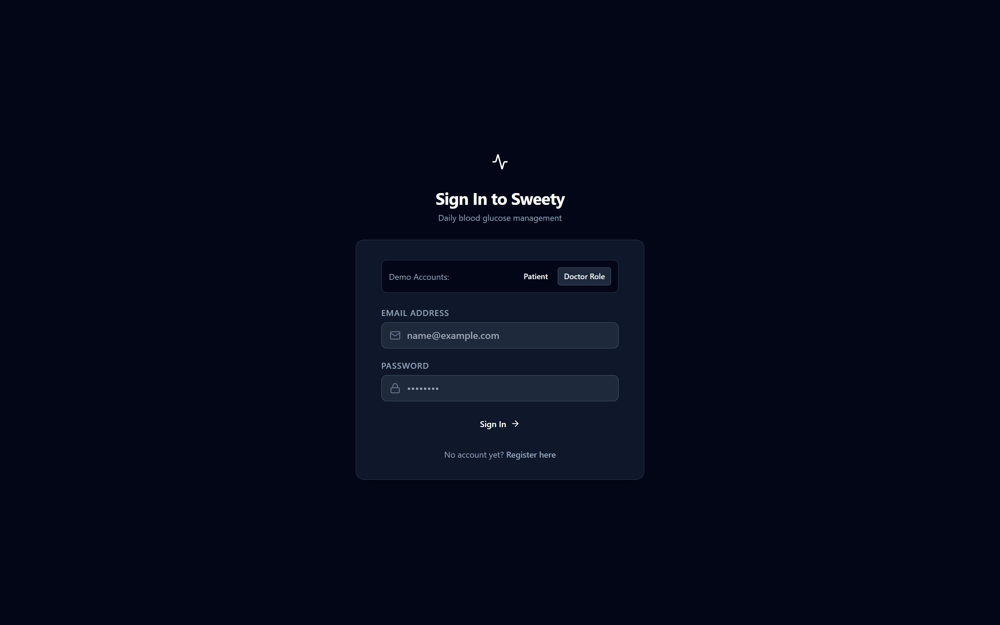

# Sweety – Blood Glucose Tracker

A web application for diabetes patients to log up to 4 blood glucose readings a day and view daily and monthly reports. Built with Node.js, Express, PostgreSQL, and React.

---

## Tech Stack

- **Backend**: Node.js, Express.js, PostgreSQL (`pg`), JWT, bcryptjs
- **Frontend**: React, Vite, Tailwind CSS, Lucide icons, Recharts
- **Testing**: Jest, Supertest (backend integration), Vitest, React Testing Library (frontend)
- **Containerization**: Docker & Docker Compose

---

## Features

### 1. Authentication
- User registration (`name`, `email`, `password`) and login.
- Passwords hashed with `bcrypt`.
- JWT authentication middleware protecting API routes.
- Strict data isolation: patients only access their own readings.

### 2. Readings CRUD & Validations
Readings consist of a `reading_date`, a `slot`, and a `value` (in mg/dl).
The 4 allowable slots:
- `Morning (fasting)`
- `After breakfast`
- `After lunch`
- `After dinner`

Validation rules enforced on both API and UI:
- **Value is required**: `"Please enter a glucose value."`
- **Value range (40–600 mg/dl, whole number)**: `"Value must be between 40 and 600 mg/dl."`
- **Single reading per slot per day**: `"You already have an After lunch reading for this date."`
- **Maximum 4 readings per day**: `"You can add only 4 readings per day."`
- **No future dates**: `"Date cannot be in the future."`

### 3. Reports
For any chosen reference date (defaults to today):
- **Daily**: Selected date's highest, lowest, average (rounded to 1 decimal), total readings count, and a list of readings with their slots.
- **Month-to-Date**: From the 1st of the month to the selected date (highest, lowest, average, count).
- **Monthly (Previous Month)**: The entire previous calendar month (highest, lowest, average, count).
- **Empty State**: Friendly message when no readings exist for the selected date range.

---

## Application Screenshots

| 1. Modern Minimal Dashboard | 2. Reading Form Modal |
| :---: | :---: |
|  |  |

| 3. Validation Rules in Action | 4. Reports & Trends (Recharts) |
| :---: | :---: |
|  |  |

| 5. Doctor Portal (Bonus Feature) | 6. Authentication Page |
| :---: | :---: |
|  |  |

---

## Screen Recording Walkthrough (2–3 Minutes)

To record or demonstrate the application workflow, follow this 2-minute walkthrough path:

1. **Sign In (0:00 – 0:20)**
   - Open `http://localhost:5173`.
   - Click the **"Patient"** demo button to autofill `demo@sweety.com` / `password123`.
   - Click **Sign In**.
2. **Dashboard & Daily Overview (0:20 – 0:50)**
   - Review the 4-slot progress tracker (`Fasting`, `Breakfast`, `Lunch`, `Dinner`).
   - Notice today's mean glucose value card and glycemic reference scale rail.
   - Scan the paginated readings journal with color-coded classification pills.
3. **Log a Reading & Test Validations (0:50 – 1:30)**
   - Click **"Log Glucose Reading"** to open the modal.
   - Enter `35` mg/dl and click Save ➡️ see validation error `"Value must be between 40 and 600 mg/dl."`
   - Select tomorrow's date ➡️ see validation error `"Date cannot be in the future."`
   - Enter `115` mg/dl for today's pending slot and save ➡️ see the slot indicator light up and the table update instantly.
4. **Reports & Trends (1:30 – 2:05)**
   - Click **Reports & Trends** in the top navigation.
   - Review the 3 analytical cards: **Daily** (with slot breakdown list), **Month-to-Date**, and **Monthly (Previous Month)** with 1-decimal rounding.
   - Review the interactive Recharts month-to-date curve with clinical target area (`70–140 mg/dl`).
5. **Doctor Portal (2:05 – 2:30)**
   - Log out and click **"Doctor Role"** (`doctor@sweety.com`).
   - Access the Doctor Oversight Portal to view assigned patients, their reading counts, and their clinical reports.

### Bonus Tasks Implemented
- **Redis report caching**: Automatically caches computed report results in Redis (1h TTL) and invalidates keys immediately whenever a reading is added, edited, or deleted. Includes graceful offline fallback if Redis is not running.
- **Doctor role**: Clinician account (`doctor@sweety.com`) with dedicated oversight portal to view assigned patient logs, summaries, and trend charts.
- **Pagination on `GET /api/readings`**: Supports `?page=1&limit=20` (custom page & limit) with full pagination metadata.
- **Charts**: Month-to-date blood glucose trend curve using Recharts with target zone boundaries (70–140 mg/dl).
- **Docker**: `docker-compose.yml` orchestrating PostgreSQL 16, Redis 7, Node/Express API, and React/Nginx client.
- **Frontend tests**: React Testing Library + Vitest test suite for reading form validations.
- **Seed script**: Automated generator populating realistic demo patient and doctor accounts with historical readings.

---

## Getting Started

### Prerequisites
- Node.js (v18+)
- PostgreSQL (v14+) running on port 5432, or Docker

### 1. Database Setup
Create the application database and test database in PostgreSQL:

```sql
CREATE DATABASE sweety_db;
CREATE DATABASE sweety_test_db;
```

### 2. Server Setup & Seeding

```bash
cd server
npm install
cp .env.example .env
```

Review `server/.env` if your PostgreSQL username/password differs from default `postgres`.

Run migrations and database seeding:

```bash
# Run table schema migration
npm run migrate

# Seed demo user and historical readings
npm run seed
```

Start the server:
```bash
npm start
# or for auto-reload:
npm run dev
```
The API will run at `http://localhost:5000`.

### 3. Client Setup

In a separate terminal:

```bash
cd client
npm install
cp .env.example .env
npm run dev
```

Open `http://localhost:5173` in your browser.

---

## Demo Accounts

The seed script (`npm run seed`) provisions two test accounts:

| Role | Email | Password | Access Capabilities |
| :--- | :--- | :--- | :--- |
| **Patient** | `demo@sweety.com` | `password123` | Log up to 4 readings/day, view personal daily/monthly reports & trends |
| **Doctor** | `doctor@sweety.com` | `password123` | View assigned patients, inspect patient reports & trend curves |

*(Quick access buttons for both Patient and Doctor are available on the login page.)*

---

## Running Tests

### Backend Tests (Jest + Supertest)
Runs all unit and integration tests covering authentication, validations, and report calculations:

```bash
cd server
npm test
```

### Frontend Tests (Vitest + React Testing Library)
Tests form rendering and error messages for empty values, invalid ranges, and future dates:

```bash
cd client
npm test
```

---

## Docker Setup

To run the entire application via Docker Compose:

```bash
docker-compose up --build
```

- Frontend: `http://localhost:3000`
- Backend API: `http://localhost:5000/api`

---

## Notes & Assumptions

### Assumptions
1. **Date format**: Dates are treated as ISO date strings (`YYYY-MM-DD`) without UTC conversion offset shifts to ensure patient readings stay locked to the calendar date they were entered on.
2. **Previous Month logic**: When a user selects any date, the "Monthly" report strictly computes the complete preceding calendar month (e.g. for `2026-10-15`, it covers `2026-09-01` to `2026-09-30`).
3. **Target glucose range**: Readings between 70 and 140 mg/dl are highlighted as standard target range; `< 70` is flagged as low, `141–199` as elevated, and `≥ 200` as high.

### What I'd improve with more time
- **Critical alerts**: Real-time email or SMS alert when a patient logs recurrent hypoglycemia (< 70 mg/dl).
- **Export options**: Add PDF and CSV export for patients to bring to appointments.
- **Background reminders (BullMQ + Redis)**: Send an evening reminder email/notification to patients with fewer than 4 readings logged for the day.
- **Offline support**: Service Worker caching so patients can log readings without network access and sync when back online.
